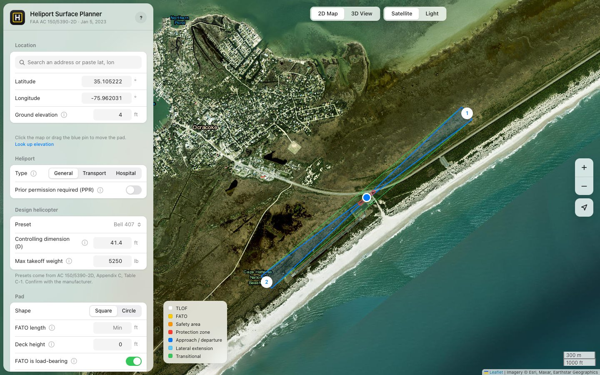
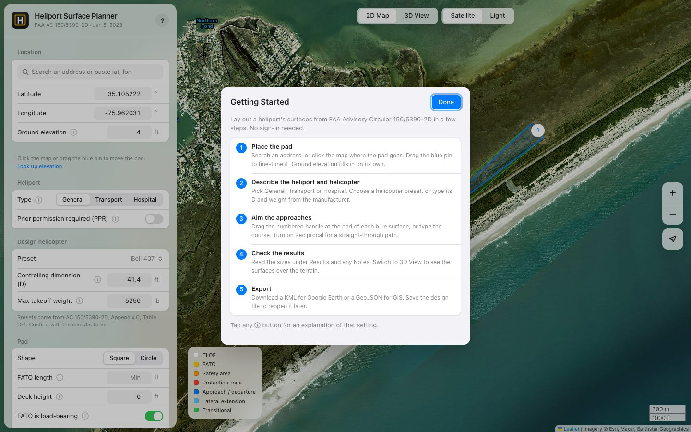
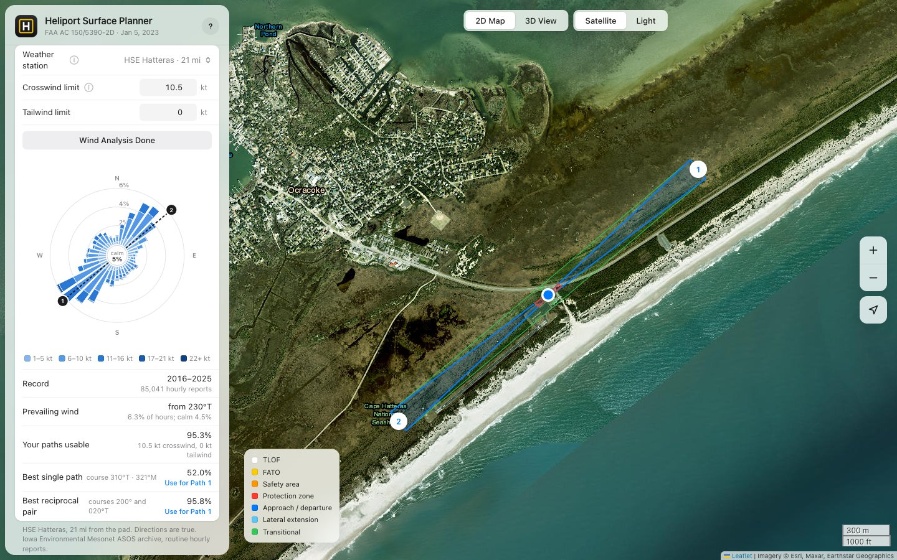
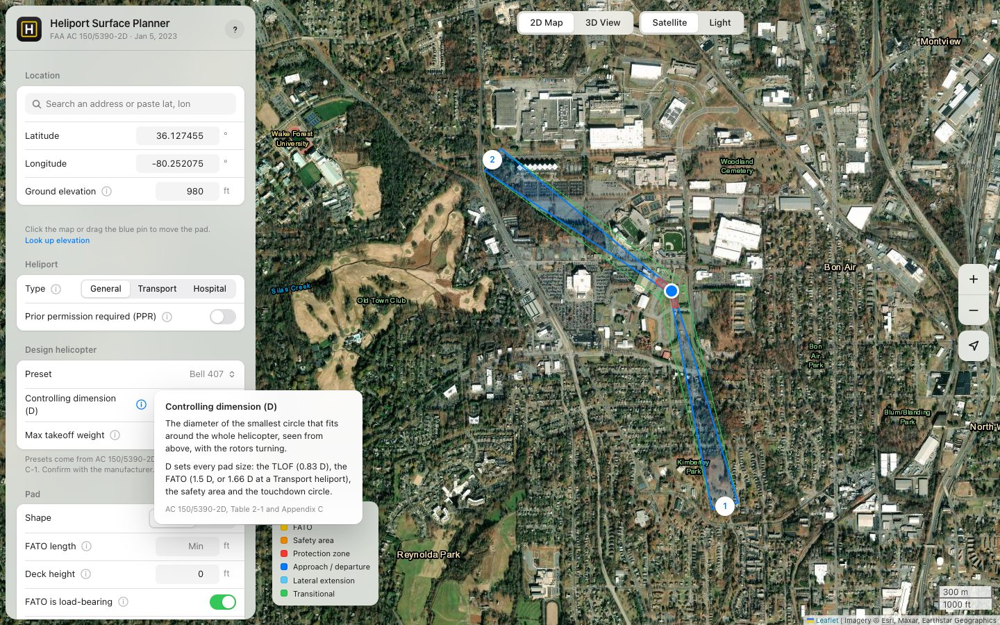
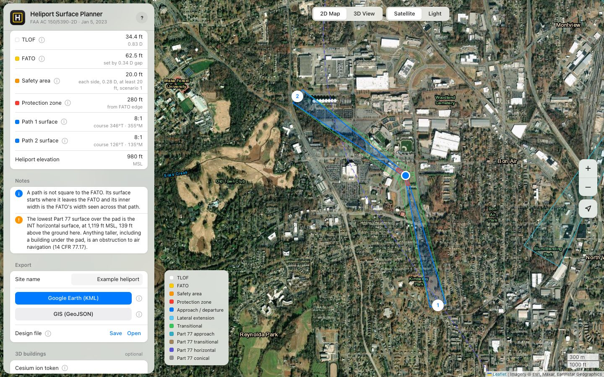
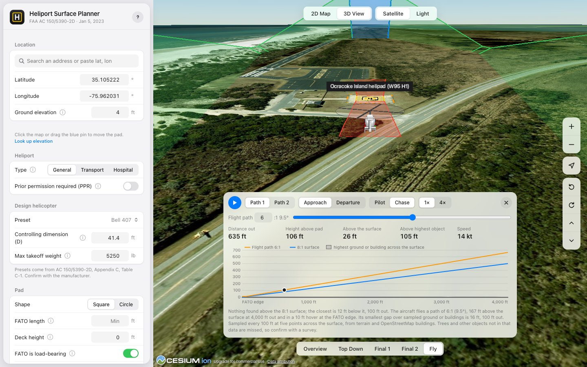
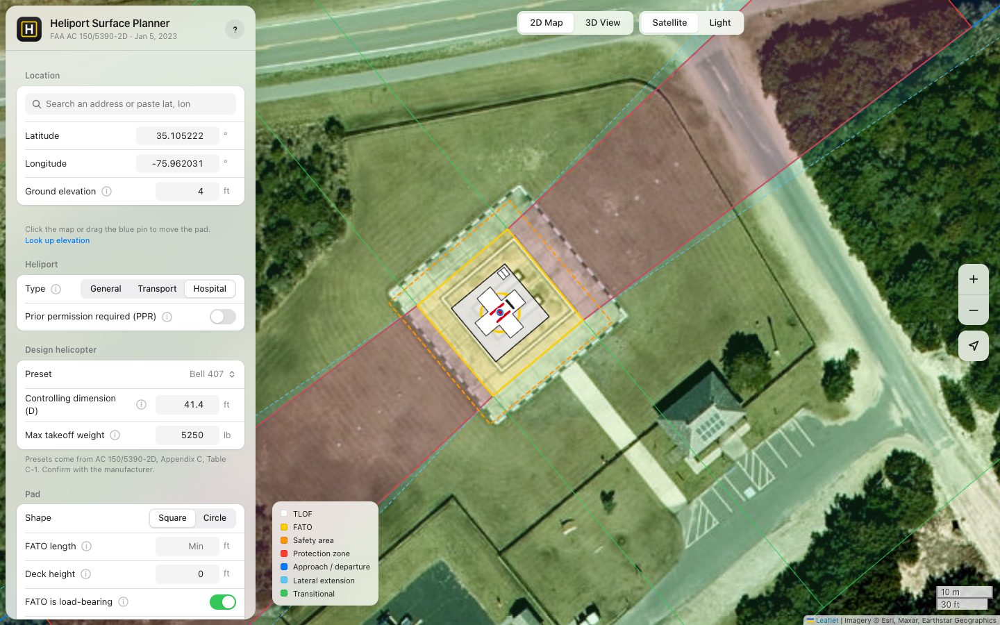
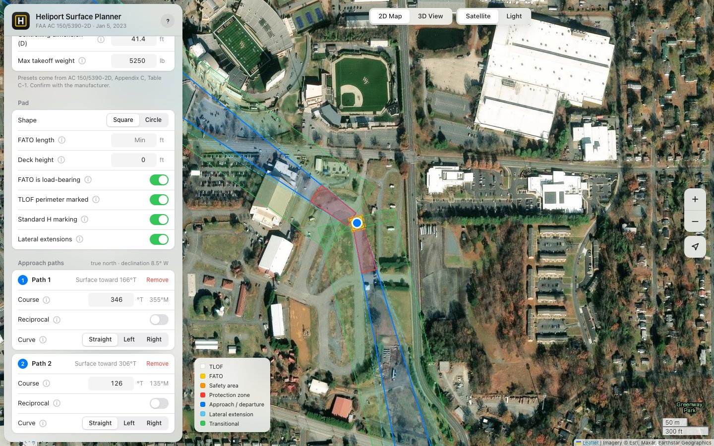

# Heliport Surface Planner

Draw a heliport's protected areas on a map in a few minutes, using the FAA's current heliport design standard. Export the result to Google Earth or GIS.

This is a companion app to the [Vertiport Surface Planner](https://basilbuildsai.github.io/vertiport-surface-planner/) ([repo](https://github.com/basilbuildsai/vertiport-surface-planner)), which does the same job for VTOL aircraft under the FAA's draft vertiport standard, AC 150/5390-4. The two tools share the same layout, controls and export formats.



The examples in this guide use the helipad at Ocracoke Island Airport (W95) on the Outer Banks of North Carolina, listed in NASR as H1, a 100 ft concrete pad. The design has two one-way approach paths, from the northeast and the southwest along the runway, and a Bell 407 as the design helicopter. The sample exports are in [`docs/examples`](docs/examples).

The planner follows FAA Advisory Circular 150/5390-2D, *Heliport Design*, dated January 5, 2023. You give it a location, the heliport type, a helicopter and the directions helicopters will arrive from. It works out the size of the landing pad and its safety area, and draws the 8:1 approach surfaces that must stay clear of obstacles.

It runs in a web browser. There is nothing to install and no account to create.

## Open the planner

**Online (recommended):** go to https://basilbuildsai.github.io/heliport-surface-planner/ in Chrome, Edge, Safari or Firefox. Everything works, including the 3D view.

**From a downloaded copy:** on this GitHub page, click the green **Code** button, then **Download ZIP**. Unzip it, open the `tool` folder, and double-click `heliport-surfaces.html`. The map, the measurements and the exports all work this way. The 3D view does not, because browsers restrict it for files opened from your computer; use the online link for 3D.

The planner needs an internet connection for maps and elevation data. If a map stays blank on an agency network, see [If something doesn't work](#if-something-doesnt-work).

## Use it in five steps

The first time you open the planner, a Getting Started card walks through these steps. You can reopen it anytime with the **?** button at the top of the sidebar.



### 1. Place the pad

Type an address in the search box, or paste coordinates such as `35.7796, -78.6382`. You can also click anywhere on the map. Drag the blue pin to fine-tune the spot. The ground elevation fills in on its own from the U.S. Geological Survey.

### 2. Describe the heliport and the helicopter

Pick the heliport type. The AC sets different minimums for each:

- **General** aviation: the default.
- **Transport**: larger minimums. The TLOF is at least 50 ft, the FATO at least 100 ft, the safety area at least 30 ft, and the protection zone runs 400 ft instead of 280 ft.
- **Hospital**: the TLOF is at least 40 ft, and the pad gets the red H in a white cross.

Turn on **Prior permission required (PPR)** for a private-use site where pilots need the owner's permission. PPR sites get the smaller safety-area minimums and may have a single approach path.

Then pick the design helicopter from the Preset list, or type two numbers from the manufacturer:

- **Controlling dimension (D):** the width of the smallest circle that fits around the whole helicopter, seen from above, rotors turning.
- **Max takeoff weight:** in pounds. It goes in the size and weight box on the pad.

The presets come from Appendix C, Table C-1 of the AC.

### 3. Aim the approaches

Each blue band is an approach path. Drag the numbered white handle at its end to point it where helicopters will fly in, or type the course in degrees from true north. The magnetic course shows beside it, from the World Magnetic Model 2025. Every surface is 8:1, as 2.12.2 requires. Turn on **Reciprocal** if helicopters can use the same line in both directions. Use **Add Path** for another direction.

The AC recommends two approach/departure paths where practicable and, without wind data, at least 135° between the preferred path and another (1.9.1, 2.12.1). These are recommendations, so a layout that misses them gets an orange warning, not a failure. A PPR heliport may have one path.

To bend a path around buildings or terrain, set **Curve** to Left or Right (as seen from the pad looking out). Then set the straight leg (at least 1,000 ft), the radius (at least 886 ft) and the turn. The AC allows one curve per path (2.12.3).

### Check the wind

Under **Wind**, the planner picks the nearest weather station with ten full years of hourly reports. Set the helicopter's crosswind and tailwind limits, then click **Run Wind Analysis**. It downloads the reports from the Iowa Environmental Mesonet archive, which takes about a minute, and draws a wind rose with your paths on it. It then shows the prevailing wind, how often your paths are usable, and the best single path and reciprocal pair. **Use for Path 1** aims Path 1 to match. This supports the AC's advice to align the preferred path with the predominant wind (1.9.1). Results are saved in your browser, so the next run for that station is instant.



At Ocracoke the nearest station is Hatteras (HSE), 21 miles away, with 85,041 hourly reports from 2016 to 2025. The prevailing wind is from 230°T and calm 4.5% of the time. The two runway-aligned paths are usable 95.3% of the time at a 10.5 kt crosswind limit and no tailwind. The best reciprocal pair, courses 200° and 020°T, would reach 95.8%, so lining the pad up with the runway costs half a percentage point.

### 4. Check the results

The **Results** section lists every size the AC requires, with the rule that set it, and **Notes** flags anything that needs attention. Red notes mark a standard the layout doesn't meet; orange notes mark a recommendation it misses.

Every setting and result has a small **ⓘ** button. Click it for a plain-language explanation and the AC paragraph it comes from.



### 5. Export

Name the site, then click **Google Earth (KML)** or **GIS (GeoJSON)**. The file saves to your Downloads folder. If the layout breaks a standard, the planner lists the failed checks first. If you export anyway, the file is marked non-standard: the KML name and summary say so, and both formats carry a `non_standard` flag and the list of `failed_checks`. Click **Save** under Design file to keep your settings, and **Open** to load them again later or share them with a colleague.



## See it in 3D

Click **3D View** at the top of the map. The surfaces appear in the air at their real heights over the terrain. Use the buttons on the right to zoom, rotate and tilt, and the bar at the bottom for preset views. On a laptop trackpad, drag to move and pinch to zoom. Click **Light** at the top for a plain gray map that makes the surfaces easier to read.

### Fly a path

Click **Fly** in the bar at the bottom of the 3D view. A generic single-rotor helicopter, sized from your D and not modeled on any real type, flies the chosen path from 4,000 ft out to a hover over the pad. Choose **Departure** to fly it outbound. **Pilot** shows the view from the cockpit and **Chase** follows from behind. Drag the slider to scrub.



The approach surface is the floor that obstacles must stay below, not the path the helicopter flies. The helicopter flies its own **Flight path**, 6:1 (9.5°) unless you change it. That sits inside the 7° to 12° "normal" approach range in Table G-1 of the AC. The readout shows how far the skids are above the surface and above the highest object below. A flight path shallower than the 8:1 surface shows in red.

Under the flight is a profile of the path: the flight path, the 8:1 surface, and the highest ground or building across the surface's width every 100 ft. Anything that rises into the surface shows in red, and the note under the chart says where. Without a Cesium token the profile uses terrain only. Trees aren't in either data set, so confirm with a survey.

### Optional: show 3D buildings

To see which buildings rise into an approach surface, add a free Cesium ion token. Click the **ⓘ** next to "Cesium ion token" in the sidebar for these same steps:

1. Go to https://ion.cesium.com/signup and create a free account. Signing up with Google is quickest.
2. When asked how you'll use it, choose "I'm a developer who wants to use Cesium ion in my apps."
3. Click **Access Tokens** at the top of the page, then the token named **Default**.
4. Copy the long token and paste it into the **Cesium ion token** box in the planner.

The token is saved only in your browser. Cesium's free Community plan is for noncommercial use, so check Cesium's terms before using it for agency work. Nothing else in the planner needs a key or an account.

## Nearby airspace and airports

Under **Nearby aviation** in the sidebar, two switches add FAA data around the pad:

- **Class B, C and D airspace** draws controlled airspace the way a sectional chart does: Class B solid blue, Class C solid magenta, Class D dashed blue. Hover an area for its floor and ceiling. If the pad sits inside or under one, Notes says so and what ATC contact flights there need.
- **Airports and heliports** shows every open landing facility within about 50 miles: airports, heliports, seaplane bases, gliderports, ultralight parks and balloonports. Use the buttons under the switch to pick types. The three nearest are listed by name and distance.

In 3D View each airspace area is a block from its floor to its ceiling.

Both layers come from the FAA's NASR 28-day subscription and are built into the planner, so they work offline. The cycle date shows under each switch. The FAA updates NASR every 28 days, so check the current sectional chart before relying on it.

## Part 77 surfaces

The **Part 77 surfaces** switch draws the imaginary surfaces of 14 CFR 77.19 for every public-use airport within 20 miles: the primary surface along each runway, the approach surfaces off each end, the 7:1 transitional surfaces, the horizontal surface 150 ft above the airport, and the 20:1 conical surface beyond it. An object that rises through any of them is an obstruction to air navigation under 14 CFR 77.17.

The FAA does not publish these surfaces as map data, but it does publish everything needed to build them. Each runway end in the FAA's NASR records carries its Part 77 category (utility or larger, visual, nonprecision or precision), along with its position and elevation. The planner applies the 77.19 dimensions to those records. Notes reports the lowest surface over the pad: at the Ocracoke pad, that is the W95 transitional surface beside the runway 24 approach, at 28 ft MSL, 24 ft above the ground.

Two simplifications: runway ends with no category in NASR are drawn as utility visual (the smallest case), and the transitional surfaces stop at the horizontal surface, leaving out the extra 5,000 ft beside precision approaches. The surfaces are included in the KML and GeoJSON exports while the switch is on. For a real project, the FAA's obstruction evaluation (Form 7460-1) and the airport's Airport Layout Plan govern.

## Pad markings

The planner draws the TLOF markings from Chapter 4 of the AC:

- the white H, 10 ft tall and 6 ft 8 in wide, in the center of the TLOF, with a 1 ft black bar 2 ft below it;
- the yellow touchdown/positioning circle, 18 in wide, with an inner diameter of half of D;
- the size and weight box in the lower-right corner (right of the H on a circular TLOF): the weight in thousands of pounds on top and "D" plus the controlling dimension below. With a weight of 0 the top half gets the diagonal line for "no weight limit."

At a Hospital heliport the H is red, inside a 30 ft white cross with 10 ft arms (Figure 4-3). All markings read upright to a pilot flying Path 1, so on a north-up map they may look rotated. Zoom in all the way to see them.



Two switches under **Pad** change the safety area, as Table 2-4 sets out for General, Hospital and PPR heliports. Turning off **TLOF perimeter marked** raises it from 0.28 D to 0.5 D. Turning off **Standard H marking** raises its minimum width.

## Lateral extensions for hospital and PPR heliports

At Hospital and PPR heliports the AC offers lateral extensions of the 8:1 approach surface (2.12.2, Figure 2-17). Each side gets a strip that grows from nothing at the FATO to 100 ft wide at 2,000 ft out (Area B), then stays 100 ft wide to 4,000 ft (Area A). An obstacle may rise into Area A or Area B, but not both, if it is marked or lighted and the FAA finds it is not a hazard. Turn on **Lateral extensions** under **Pad** to draw them in light blue.



The text of 2.12.2 and the figure leave some room for reading. The planner takes Area B as the tapering inner 2,000 ft and Area A as the constant-width outer 2,000 ft, from the labels in Figures 2-17 and 2-18.

## Open your export in Google Earth or GIS

To see what an export looks like before you make one, open the samples in [`docs/examples`](docs/examples).

### Google Earth

You don't need to install anything. Google Earth on the web opens the KML file directly:

1. Go to https://earth.google.com and sign in with any Google account.
2. Click **Local KML editor** at the bottom left, then **Open KML/Z from device**, and pick the `.kml` file.

The file stays on your computer; nothing is uploaded to your Google account.

If you prefer the desktop app, Google Earth Pro is a free download from Google. Choose File, then Open, and pick the `.kml` file. Google Earth Pro also fills the sloped surfaces with color; the web version mostly shows their outlines.

The pad areas lie on the ground. The approach and transitional surfaces float at their true altitude, so tilt the view to see them. If a surface starts above or below the pad, the ground elevation in the planner differs from Google Earth's terrain; type Google Earth's elevation into the planner and export again.

### QGIS

Drag the `.geojson` file onto the map. QGIS gives every shape the same random color at first. To color it like the planner, download [`heliport-surfaces.qml`](docs/qgis/heliport-surfaces.qml), then right-click the layer, choose **Properties**, then **Style**, and at the bottom pick **Style**, then **Load Style**, and choose that file.

### ArcGIS Pro

Run the **JSON To Features** geoprocessing tool on the `.geojson` file.

Coordinates are WGS 84 longitude and latitude (EPSG:4326). Heights are meters above mean sea level.

## What the planner draws

| On the map | What it is | Size rule | AC 150/5390-2D |
|---|---|---|---|
| White square | TLOF, the touchdown and liftoff area | 0.83 D; at least 50 ft (Transport) or 40 ft (Hospital); at least 1 D on an elevated pad whose FATO can't carry the helicopter | Table 2-1, 2.7.2.1 |
| Yellow square | FATO, the final approach and takeoff area | The larger of 1.5 D (1.66 D and at least 100 ft for Transport) and the TLOF plus 0.34 D on every side | Table 2-1, 2.8 |
| Orange dashed line | Safety area around the FATO | Transport: 0.42 D, at least 30 ft. Others: 0.28 D or 0.5 D, with a 10 to 30 ft minimum, by marking scenario | Table 2-1, Table 2-4 |
| Red | Heliport protection zone | The first 280 ft under each approach surface (400 ft for Transport) | 2.13, Figure 2-20 |
| Blue | Approach and departure surface | Starts at the FATO edge, rises at 8:1 and widens to 500 ft at 4,000 ft out, 500 ft above the heliport | 2.12.2, Figure 2-15 |
| Light blue, dashed | Lateral extensions (Hospital and PPR, optional) | 0 to 100 ft wide over the first 2,000 ft, then 100 ft to 4,000 ft, each side | 2.12.2, Figure 2-17 |
| Green | Transitional surfaces | Rise at 2:1 from the sides of the approach surface and the FATO, out to 250 ft from the centerline | 2.12.2 |
| Yellow ring | Touchdown/positioning circle | Inner diameter 0.5 D, 18 in wide | 4.4.2 |
| White, outlined | H, hospital cross and size/weight box | H 10 ft by 6 ft 8 in; cross 30 ft; box 5 ft, or 10 ft on a TLOF of 60 ft or more | 4.3, 4.4.3, Figures 4-1 to 4-3 |

Sites above 1,000 ft elevation get a longer FATO, read from Figure 2-11 of the AC to within about 5 ft. The AC's worked example, 80 ft at 3,200 ft, lands on the curve. For elevated heliports, 2.8.5 lets helicopter performance be considered instead, and Notes says so.

Approach paths can be straight or curved (2.12.3, Figure 2-16). Courses show in true and magnetic.

Not drawn yet: elongated FATOs with two takeoff positions (Table 2-2), TLOFs outside the FATO, taxiways, taxi routes and parking positions (Chapter 3), wind cone siting (2.14), helicopter facilities on airports (Chapter 5) and instrument approach surfaces (Chapter 6).

## If something doesn't work

**The map is blank or gray.** Your network may block a map service. Ask IT to allow these sites: `server.arcgisonline.com`, `elevation3d.arcgis.com`, `cdn.jsdelivr.net`, `cdnjs.cloudflare.com`, `epqs.nationalmap.gov`, `api.open-meteo.com`, `photon.komoot.io` and `mesonet.agron.iastate.edu` (wind analysis). The **Data sources** link at the bottom of the sidebar lists what each one provides.

**The 3D view says it is unavailable.** You opened the downloaded file from your computer. Use the online link instead.

**3D buildings don't appear.** Paste a Cesium ion token in the sidebar (see above). If you already did, the token may have been copied incompletely; copy it again.

**The ground elevation is wrong.** Type the surveyed elevation in the Ground elevation box. The lookup uses USGS data in the United States and coarser Open-Meteo data elsewhere.

**Search doesn't find the address.** Add the city and state, or paste latitude and longitude instead.

## Terms used

| Term | Meaning |
|---|---|
| AC | Advisory Circular, the FAA's guidance document |
| D | Controlling dimension: the smallest circle around the whole helicopter, rotors turning |
| MTOW | Maximum takeoff weight |
| TLOF | Touchdown and liftoff area |
| FATO | Final approach and takeoff area |
| HPZ | Heliport protection zone |
| TDPC | Touchdown/positioning circle |
| PPR | Prior permission required: a private-use heliport |
| 8:1 | Surface slope: 1 ft up for every 8 ft out |
| °T | Degrees from true north |
| °M | Degrees from magnetic north (World Magnetic Model 2025) |

## Important

This is a planning sketch. It is not an FAA airspace determination, a design approval, or a substitute for an engineer's review. FAA Form 7480-1 notice and the FAA's airspace review still apply to any new or changed heliport (1.10).

## For developers

The whole planner is one HTML file, `tool/heliport-surfaces.html`. The geometry is a set of pure functions in the `<script id="geometry">` block, with no page dependencies, so it can be tested in Node. It uses Leaflet for the 2D map and CesiumJS for the 3D view, both loaded from public CDNs.

The airspace, airport and runway (Part 77) layers live in `tool/data/`. To refresh them for a new NASR cycle, download the subscription from https://www.faa.gov/air_traffic/flight_info/aeronav/aero_data/NASR_Subscription/ and run:

```
scripts/build_airspace.sh <class_airspace_shape_files.zip> <cycle date>
python3 scripts/build_facilities.py <DD_Mon_YYYY_CSV.zip> <cycle date>
```

`build_facilities.py` writes both `facilities.js` and `runways.js`.

The weather station list for the wind analysis, `tool/data/asos-stations.js`, comes from the Iowa Environmental Mesonet's ASOS network lists. To refresh it, download `https://mesonet.agron.iastate.edu/geojson/network/<ST>_ASOS.geojson` for each state into a folder and run `python3 scripts/build_asos_stations.py <folder> <download date>`. Magnetic courses use the World Magnetic Model 2025 coefficients, built into the geometry block; replace them when WMM2030 is released.

The airspace script needs GDAL (`ogr2ogr`). The current files are from the October 29, 2026 cycle.

To serve it on your own network:

```
python3 -m http.server 8080 --directory tool
```

`source/faa_ac_150-5390-2D/` holds AC 150/5390-2D and a text extract, downloaded from faa.gov on November 8, 2026.

## License

The planner is source-available under the [PolyForm Noncommercial License 1.0.0](LICENSE.md). It is not "open source" in the OSI sense, because commercial use is not allowed.

You may use, change and share it for any noncommercial purpose. The license also allows use by government institutions, public safety and health organizations, schools, charities and public research organizations, whatever their funding.

Commercial use needs a separate license. That includes paid consulting or engineering work, use inside a for-profit company, and use in a commercial product. To ask about a commercial license, fill out the [commercial license request form](https://docs.google.com/forms/d/e/1FAIpQLSf1xf1FYvdN0Jw-cdIcSiQatTBELTr2MrMmcFuTI27Qir7J-w/viewform). It takes about two minutes, and Basil replies by email.

The files in `source/` are U.S. government works and are not covered by this license. Map tiles, terrain, elevation and search come from third-party services, each under its own terms.

Required Notice: Copyright 2026 Basil Yap (https://github.com/basilbuildsai)
